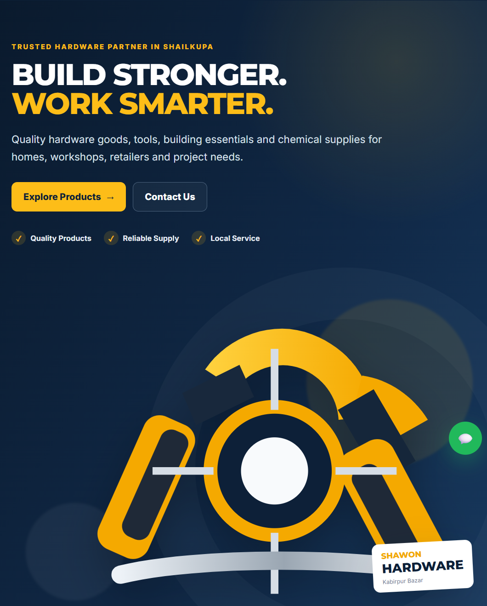
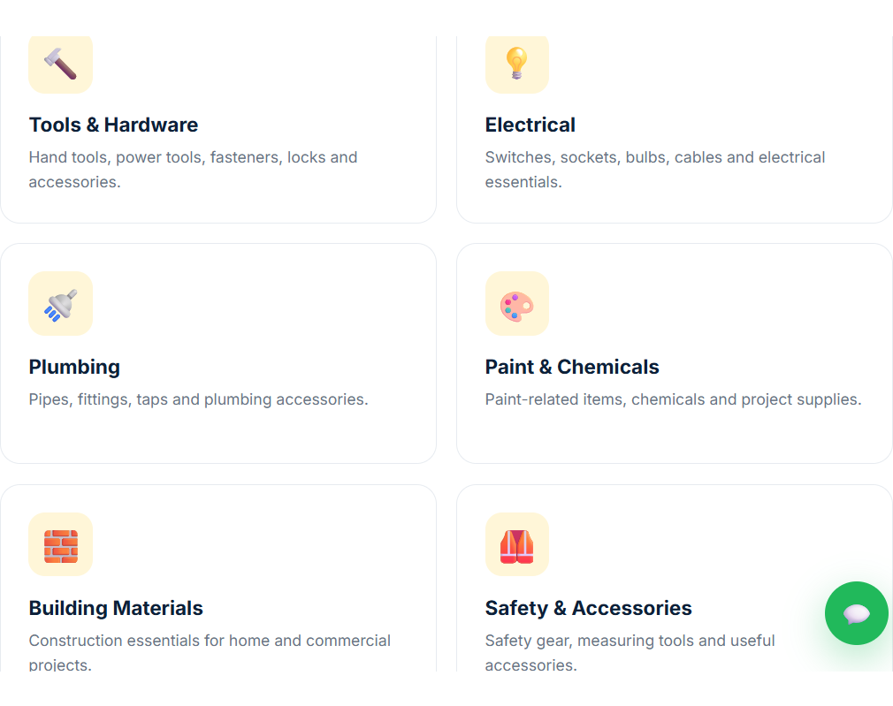
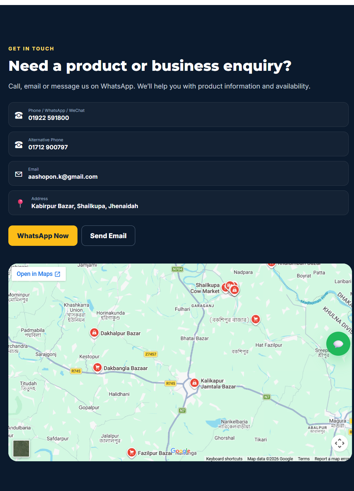

# Shawon Hardware

**Build stronger. Work smarter.**

Welcome to the online home of **Shawon Hardware**, your local source for hardware goods, tools, building essentials, and chemical supplies in Kabirpur Bazar, Shailkupa, Jhenaidah. Whether you are taking care of a home repair, stocking a workshop, or planning a project, the site makes it easy to explore product categories and get in touch.

The website also introduces Shawon Hardware's retail, supply, and import/export enquiries in one clear, easy-to-use place.

## Website preview

### Homepage

### Product categories

### Contact and location

## What you can find

- **Product categories:** tools and hardware, electrical, plumbing, paint and chemicals, building materials, and safety accessories.
- **Business information:** learn about Shawon Hardware, its services, and proprietor Shopon Kumar Biswas.
- **Quick contact:** use the phone, WhatsApp, and email links to ask about products and availability.
- **Location:** find the shop at Kabirpur Bazar, Shailkupa, Jhenaidah, with an embedded map.
- **Responsive layout:** browse the site on desktop and mobile.

## Run locally

No installation, database, or build step is required:

1. Download or clone this repository.
2. Open `index.html` in a web browser.

## Built with

HTML, CSS, and vanilla JavaScript.

## Business details

| | |
|---|---|
| **Proprietor** | Shopon Kumar Biswas |
| **Phone / WhatsApp / WeChat** | 01922 591800 |
| **Alternative phone** | 01712 900797 |
| **Email** | [aashopon.k@gmail.com](mailto:aashopon.k@gmail.com) |
| **Address** | Kabirpur Bazar, Shailkupa, Jhenaidah, Bangladesh |
| **Business** | Export and import of hardware goods and chemicals |
